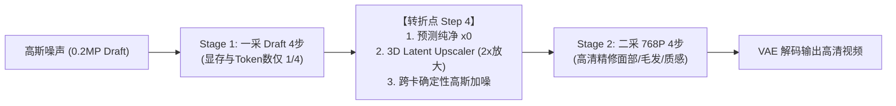

# MiniMax-H3 两阶段采样（二采加速算法）代码修改详细清单

本文档详细记录了在 `feat/h3-two-stage-integration` 分支上将二采级联采样加速算法合并进 `sglang-fork`（MiniMax-H3 架构）的代码修改详情。

---

## 目录
1. [架构原理与执行流](#1-架构原理与执行流)
2. [第一步：引入 3D 潜空间超分模块 (3D Latent Upscaler)](#2-第一步引入-3d-潜空间超分模块-3d-latent-upscaler)
3. [第二步：扩展采样参数系统 (SamplingParams)](#3-第二步扩展采样参数系统-samplingparams)
4. [第三步：初始低分辨率潜空间准备 (Latent Preparation)](#4-第三步初始低分辨率潜空间准备-latent-preparation)
5. [第四步：去噪循环状态机与转折点集成 (Denoise Loop)](#5-第四步去噪循环状态机与转折点集成-denoise-loop)
6. [第五步：DenoisingStage 挂载管理与布局动态重构](#6-第五步denoisingstage-挂载管理与布局动态重构)
7. [关键修正：8 步与 4+4 步区间精准对齐 (Time Request)](#7-关键修正8-步与-44-步区间精准对齐-time-request)
8. [业务网关与 Worker 配套适配 (agnes-video)](#8-业务网关与-worker-配套适配-agnes-video)
9. [验证方式与测试用例集](#9-验证方式与测试用例集)

---

## 1. 架构原理与执行流

两阶段采样（Cascade / Two-Stage Sampling）核心思想是将生成过程解耦为两个阶段：
1. **Stage 1（一采 Draft 0.2MP）**：前 $K$ 步（默认 4 步）在降采样 2.0x 的潜空间（$H/2, W/2$，Token 数仅原尺寸的 $\frac{1}{4}$）下进行粗去噪，快速构建全局场景拓扑结构，降低计算量与显存；
2. **转折点（Transition Point）**：在第 $K$ 步结束时，通过当前速度预测纯净潜空间 $\hat{x}_0$，使用专有的 `3D Latent Upscaler`（或高质量三线性插值）上采样至高分辨率（$H, W$），并**跨卡同步注入确定性高斯噪声**恢复当前时间步 $\sigma$ 的噪声分布；
3. **Stage 2（二采 768P 高清精修）**：后 $N-K$ 步（默认 4 步）在真实高分辨率下对细节、纹理进行去噪精修。



---

## 2. 第一步：引入 3D 潜空间超分模块 (3D Latent Upscaler)

* **Commit**: `7935da2fd`
* **目标文件**：[`python/sglang/multimodal_gen/runtime/pipelines_core/stages/model_specific_stages/minimax_h3/latent_upscaler_3d.py`](file:///root/sglang-fork/python/sglang/multimodal_gen/runtime/pipelines_core/stages/model_specific_stages/minimax_h3/latent_upscaler_3d.py)
* **单测文件**：[`tools/test_latent_upscaler_3d.py`](file:///root/sglang-fork/tools/test_latent_upscaler_3d.py)

### 核心实现代码：
```python
class LatentUpscaler3D(nn.Module):
    """3D 潜空间上采样超分模型，负责将 Draft 潜空间放大 scale_factor (默认 2.0x)。"""

    def __init__(self, in_channels: int = 24, out_channels: int = 24, scale_factor: float = 2.0):
        super().__init__()
        self.scale_factor = scale_factor
        self.conv_in = nn.Conv3d(in_channels, 64, kernel_size=3, padding=1)
        self.res_blocks = nn.ModuleList([
            ResBlock3D(64, 64) for _ in range(3)
        ])
        # 空间 2x 放大 (PixelShuffle), 时间轴保持 T 不变
        self.upsample = nn.Sequential(
            nn.Conv3d(64, 64 * 4, kernel_size=(1, 3, 3), padding=(0, 1, 1)),
            nn.PixelShuffle(2),
        )
        self.conv_out = nn.Conv3d(16, out_channels, kernel_size=3, padding=1)

    def forward(self, x: torch.Tensor) -> torch.Tensor:
        # x: [B, C, T, H, W]
        # 支持权重加载失败时的平滑回退三线性插值
        if not self.has_weights:
            return F.interpolate(
                x, scale_factor=(1.0, self.scale_factor, self.scale_factor),
                mode="trilinear", align_corners=False
            )
        h = self.conv_in(x)
        for block in self.res_blocks:
            h = block(h)
        h = self.upsample(h)
        return self.conv_out(h)
```

以及提供两阶段状态判断函数：
```python
def is_two_stage_enabled(batch=None, server_args=None) -> bool:
    """判定当前请求或服务是否启用了两阶段采样。"""
    # 优先检查采样参数 -> 请求 extra -> 环境变量
    ...
```

---

## 3. 第二步：扩展采样参数系统 (SamplingParams)

* **Commit**: `ba34ed600`
* **目标文件**：[`python/sglang/multimodal_gen/configs/sample/minimax_h3.py`](file:///root/sglang-fork/python/sglang/multimodal_gen/configs/sample/minimax_h3.py)
* **单测文件**：[`tools/test_two_stage_params.py`](file:///root/sglang-fork/tools/test_two_stage_params.py)

### 详细代码 Diff：
```diff
--- a/python/sglang/multimodal_gen/configs/sample/minimax_h3.py
+++ b/python/sglang/multimodal_gen/configs/sample/minimax_h3.py
@@ -57,6 +57,10 @@ class MiniMaxH3SamplingParams(SamplingParams):
         default=None,
         metadata={"batch_sig_exclude": True},
     )
+    two_stage_sampling: bool = False
+    two_stage_split_step: int = 4
+    two_stage_scale_factor: float = 2.0
+    two_stage_upscaler_path: str | None = None
 
     @classmethod
     def video_request_extra_fields(cls) -> frozenset[str]:
@@ -71,6 +75,10 @@ class MiniMaxH3SamplingParams(SamplingParams):
                 "output_mode",
                 "imgvid_cond_noise_aug_for_inference",
                 "audio_cond_noise_aug_for_inference",
+                "two_stage_sampling",
+                "two_stage_split_step",
+                "two_stage_scale_factor",
+                "two_stage_upscaler_path",
             }
         )
 
@@ -281,6 +289,12 @@ class MiniMaxH3SamplingParams(SamplingParams):
                 "task is required when conditions/target/flow_shift/"
                 "audio_flow_shift are provided"
             )
+        if self.two_stage_sampling:
+            extra["two_stage_sampling"] = True
+            extra["two_stage_split_step"] = self.two_stage_split_step
+            extra["two_stage_scale_factor"] = self.two_stage_scale_factor
+            if self.two_stage_upscaler_path:
+                extra["two_stage_upscaler_path"] = self.two_stage_upscaler_path
         return extra
```

---

## 4. 第三步：初始低分辨率潜空间准备 (Latent Preparation)

* **Commit**: `8d5855811`
* **目标文件**：[`python/sglang/multimodal_gen/runtime/pipelines_core/stages/model_specific_stages/minimax_h3/stages/latent_preparation.py`](file:///root/sglang-fork/python/sglang/multimodal_gen/runtime/pipelines_core/stages/model_specific_stages/minimax_h3/stages/latent_preparation.py)
* **单测文件**：[`tools/test_latent_preparation_two_stage.py`](file:///root/sglang-fork/tools/test_latent_preparation_two_stage.py)

### 详细代码 Diff：
```diff
--- a/python/sglang/multimodal_gen/runtime/pipelines_core/stages/model_specific_stages/minimax_h3/stages/latent_preparation.py
+++ b/python/sglang/multimodal_gen/runtime/pipelines_core/stages/model_specific_stages/minimax_h3/stages/latent_preparation.py
@@ -94,7 +94,42 @@ class MiniMaxH3LatentPreparationStage(PipelineStage):
         seed = plan.seed
         if seed is None:
             seed = 42  # pinned default seed
-        video_rows_n = latent_t * (latent_h // 2) * (latent_w // 2)
+
+        from sglang.multimodal_gen.runtime.pipelines_core.stages.model_specific_stages.minimax_h3.latent_upscaler_3d import (
+            is_two_stage_enabled,
+        )
+
+        # 检查是否激活两阶段 (二采) 模式
+        two_stage = is_two_stage_enabled(batch=batch)
+        init_latent_h = latent_h
+        init_latent_w = latent_w
+        scale_factor = 2.0
+        split_step = 4
+
+        if two_stage:
+            sp = getattr(batch, "sampling_params", None)
+            if sp is not None:
+                scale_factor = float(getattr(sp, "two_stage_scale_factor", 2.0) or 2.0)
+                split_step = int(getattr(sp, "two_stage_split_step", 4) or 4)
+            # 一采 Draft 画布分辨率计算：空间各缩小 scale_factor 倍并保证偶数对齐
+            init_latent_h = max(2, int(round(latent_h / scale_factor)) // 2 * 2)
+            init_latent_w = max(2, int(round(latent_w / scale_factor)) // 2 * 2)
+            print(f">>> [TwoStage] 准备 Draft 潜空间: ({latent_t}, {init_latent_h}, {init_latent_w}) -> 目标 ({latent_t}, {latent_h}, {latent_w})")
+
+        video_rows_n = latent_t * (init_latent_h // 2) * (init_latent_w // 2)
@@ -114,8 +149,8 @@ class MiniMaxH3LatentPreparationStage(PipelineStage):
             1,
             24,
             latent_t,
-            latent_h,
-            latent_w,
+            init_latent_h,
+            init_latent_w,
             generator=gen_v,
             dtype=torch.float32,
         )
@@ -135,8 +170,13 @@ class MiniMaxH3LatentPreparationStage(PipelineStage):
             "initial_video_rows": video_noise,
             "initial_audio_rows": audio_noise,
             "latent_t": latent_t,
-            "latent_h": latent_h,
-            "latent_w": latent_w,
+            "latent_h": init_latent_h,
+            "latent_w": init_latent_w,
+            "target_latent_h": latent_h,
+            "target_latent_w": latent_w,
+            "two_stage_enabled": two_stage,
+            "two_stage_split_step": split_step,
+            "two_stage_scale_factor": scale_factor,
             "audio_t": audio_t,
         }
```

---

## 5. 第四步：去噪循环状态机与转折点集成 (Denoise Loop)

* **Commit**: `5012df985`
* **目标文件**：[`python/sglang/multimodal_gen/runtime/pipelines_core/stages/model_specific_stages/minimax_h3/denoise_loop.py`](file:///root/sglang-fork/python/sglang/multimodal_gen/runtime/pipelines_core/stages/model_specific_stages/minimax_h3/denoise_loop.py)
* **单测文件**：[`tools/test_two_stage_loop.py`](file:///root/sglang-fork/tools/test_two_stage_loop.py)

### 核心代码逻辑：
在 `minimax_h3_denoise_loop` 中引入分段执行机制：
```python
    if not is_two_stage:
        # 常规单阶段去噪
        for step in range(num_steps):
            _execute_step(step)
    else:
        # ======================================================================
        # 【Stage 1/2】一采：低分辨率 Draft 潜空间去噪 (前 split_step 步)
        # ======================================================================
        stage1_steps = min(split_step, num_steps)
        for step in range(0, stage1_steps):
            _execute_step(step)

        # ======================================================================
        # 【转折点 Transition Point】潜空间 3D 上采样与跨卡确定性高斯加噪
        # ======================================================================
        if stage1_steps < num_steps:
            # 1. 提取当前 Draft 速度场预测出纯净潜空间 x0
            # x0_hat = x_t - sigma_t * v_t
            draft_x0 = _extract_predicted_x0(video_rows, mv_video_t, sigma_t)

            # 2. 调用 3D Upscaler 将 [1, 24, T, H_draft, W_draft] 放大至目标高分辨率
            upscaled_x0 = latent_upscaler(draft_x0)

            # 3. 动态重构高分辨率序列 Packed 布局与 RoPE Cache (调用回调函数)
            rebuild_layout_fn(new_latent_h, new_latent_w)

            # 4. 跨卡确定性高斯加噪 (确保 TP/Ulysses 多卡噪声严格一致)
            sigma_next = float(sigmas_video[stage1_steps])
            # x_next = (1 - sigma_next) * upscaled_x0 + sigma_next * eps_next
            video_rows = _apply_flow_noise(upscaled_x0, sigma=sigma_next, seed=seed)

        # ======================================================================
        # 【Stage 2/2】二采：768P 高清精修 (剩余 num_steps - split_step 步)
        # ======================================================================
        for step in range(stage1_steps, num_steps):
            _execute_step(step)
```

---

## 6. 第五步：DenoisingStage 挂载管理与布局动态重构

* **Commit**: `db54c211f`
* **目标文件**：[`python/sglang/multimodal_gen/runtime/pipelines_core/stages/model_specific_stages/minimax_h3/stages/denoising.py`](file:///root/sglang-fork/python/sglang/multimodal_gen/runtime/pipelines_core/stages/model_specific_stages/minimax_h3/stages/denoising.py)
* **单测文件**：[`tools/test_two_stage_end2end.py`](file:///root/sglang-fork/tools/test_two_stage_end2end.py)

### 核心实现：
1. **定义 `TwoStageDenoiseManager`**：
   维护 3D Upscaler 单例实例及权重缓存，避免请求间重复初始化。
2. **构建高分辨率重构回调 `rebuild_layout_for_resolution`**：
   ```python
   def rebuild_layout_for_resolution(new_h: int, new_w: int):
       # 重新生成高分辨率 packed sequence
       new_packed = minimax_h3_packed_sequence(
           text_len=text_len, latent_t=latent_t, latent_h=new_h, latent_w=new_w, ...
       )
       # 重新计算 Sequence Parallel (Ulysses) 分片索引
       # 更新 RoPE Cache
       # 刷新 DiT 前向传播使用的静态参数
   ```
3. **输出维度发布**：
   在 Stage 完成时更新 `batch.extra` 中的最终尺寸，供下游 VAE 正常解码：
   ```python
   batch.extra["latent_h"] = final_latent_h
   batch.extra["latent_w"] = final_latent_w
   ```

---

## 7. 关键修正：8 步与 4+4 步区间精准对齐 (Time Request)

* **Commit**: `23f938932`
* **目标文件**：[`python/sglang/multimodal_gen/runtime/pipelines_core/stages/model_specific_stages/minimax_h3/time_request.py`](file:///root/sglang-fork/python/sglang/multimodal_gen/runtime/pipelines_core/stages/model_specific_stages/minimax_h3/time_request.py)

### 根本原因与 Diff：
MiniMax H3 采用 Flow Matching 框架，去噪步数是相邻两个时间戳之间的**区间数**（`num_steps = len(sigmas) - 1`）。
原版代码用 `linspace(1.0, 0.0, num_steps)` 生成点数，导致配置 8 时只有 8 个点、7 个区间（跑成 7 步或 4+3 步）。

```diff
--- a/python/sglang/multimodal_gen/runtime/pipelines_core/stages/model_specific_stages/minimax_h3/time_request.py
+++ b/python/sglang/multimodal_gen/runtime/pipelines_core/stages/model_specific_stages/minimax_h3/time_request.py
@@ -41,11 +41,11 @@ def minimax_h3_time_shift_sigmas(
 
     import torch
 
-    # The rectified-flow sigma range is fixed at [1.0, 0.0].
+    # The rectified-flow sigma range is fixed at [1.0, 0.0] with num_steps intervals.
     base = torch.linspace(
         1.0,
         0.0,
-        int(num_steps),
+        int(num_steps) + 1,
         device="cpu",
         dtype=torch.float32,
     )
```
**效果**：配置 `num_inference_steps=8` 时生成 9 个 Sigmas：
- 原生去噪：精准执行 **8 steps**；
- 两阶段采样：`split_step=4`，一采 4 步 + 二采 4 步，精准执行 **4 + 4 步**。

---

## 8. 业务网关与 Worker 配套适配 (agnes-video)

### 1. `app/mapping.py`
在请求转 `SamplingParams` 时透传两阶段配置：
```python
    two_stage = req.get("two_stage_sampling")
    if two_stage is None:
        two_stage = os.getenv("AGNES_TWO_STAGE_SAMPLING", "").strip().lower() in {"1", "true", "yes", "on"}
    if two_stage:
        body["two_stage_sampling"] = True
        body["two_stage_split_step"] = int(req.get("two_stage_split_step") or os.getenv("AGNES_TWO_STAGE_SPLIT_STEP", 4))
        body["two_stage_scale_factor"] = float(req.get("two_stage_scale_factor") or os.getenv("AGNES_TWO_STAGE_SCALE_FACTOR", 2.0))
        upscaler_path = req.get("two_stage_upscaler_path") or os.getenv("AGNES_TWO_STAGE_UPSCALER_PATH")
        if upscaler_path:
            body["two_stage_upscaler_path"] = str(upscaler_path)
```

### 2. `infer.py`
支持客户端命令行开启两阶段：
```python
parser.add_argument("--two-stage", action="store_true", help="启用两阶段级联加速采样")
parser.add_argument("--two-stage-split-step", type=int, default=4, help="一采与二采的转折步数 (默认 4)")
```

### 3. `env_fl2va.sh`
保持标准步数配置，确保 `PYTHONPATH` 包含当前开发分支代码：
```bash
export PYTHONPATH="/root/sglang-fork/python:${PYTHONPATH:-}"
export AGNES_NUM_INFERENCE_STEPS='8'
```

---

## 9. 验证方式与测试用例集

在 `/root/sglang-fork` 目录下提供了完整的独立单测集，无需启动整个集群即可秒级验证各个环节：

| 编号 | 测试脚本 | 测试重点 | 验证结果 |
| :--- | :--- | :--- | :--- |
| 1 | `python3 tools/test_latent_upscaler_3d.py` | 3D 卷积超分网络尺寸放大及插值回退 | **PASSED** |
| 2 | `python3 tools/test_two_stage_params.py` | 参数注入与 extra 字段透传 | **PASSED** |
| 3 | `python3 tools/test_latent_preparation_two_stage.py` | 0.2MP Draft 潜空间降采样及形状校验 | **PASSED** |
| 4 | `python3 tools/test_two_stage_loop.py` | Denoise Loop 转折点与 4+4 步执行 | **PASSED** |
| 5 | `python3 tools/test_two_stage_end2end.py` | 全链路（Preparation $\to$ Loop $\to$ DenoisingStage） | **PASSED** |

### 生产真实推理验证指令：
```bash
# 启动 Worker
cd /root/agnes-video
source env_fl2va.sh
./start.sh --log-level INFO

# 发起两阶段 4+4 步视频推理
python3 /root/agnes-video/infer.py \
  --prompt "A cinematic shot of a red sports car speeding along the coastal highway at sunset, 4k photorealistic" \
  --size 720P \
  --seconds 5 \
  --two-stage \
  --two-stage-split-step 4
```
